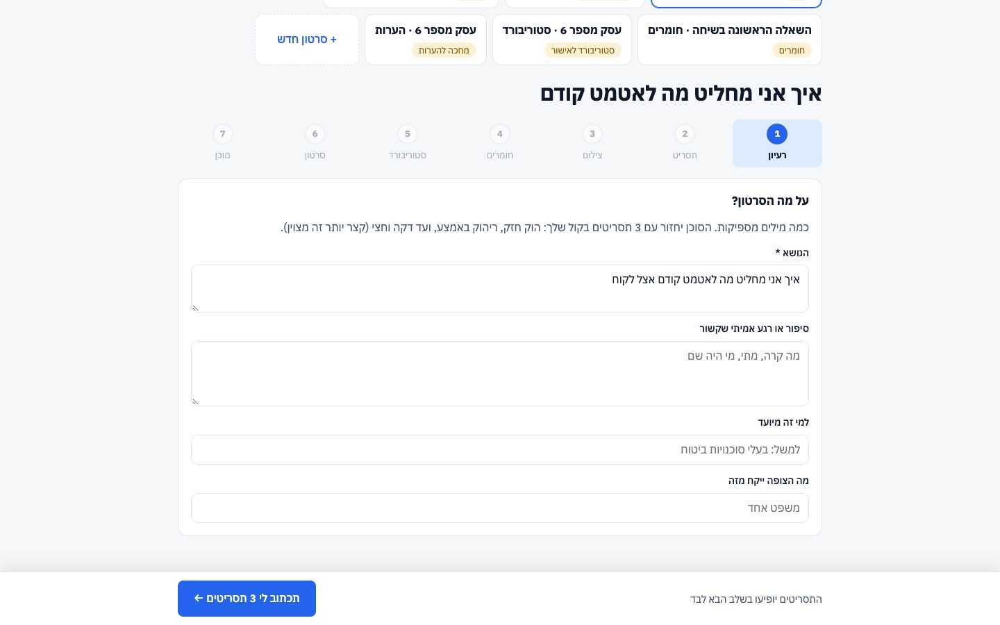
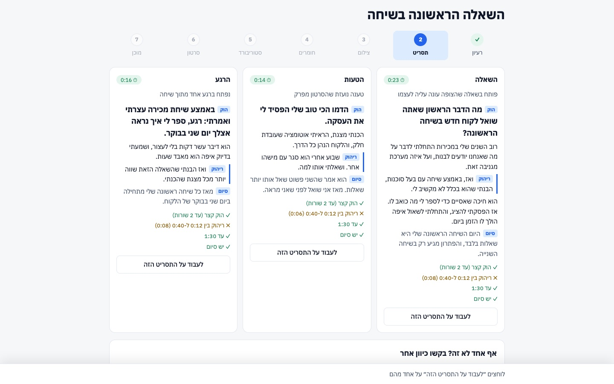
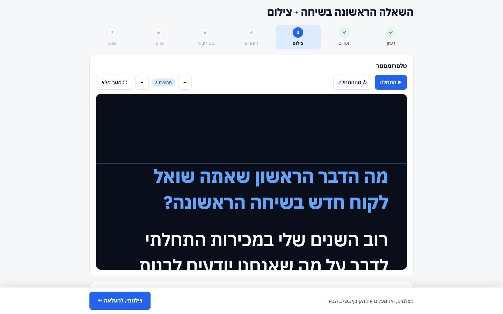
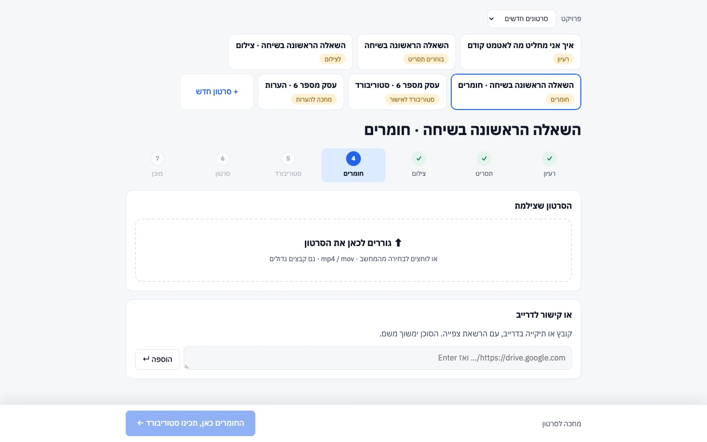
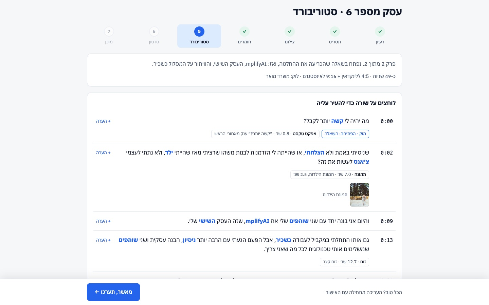
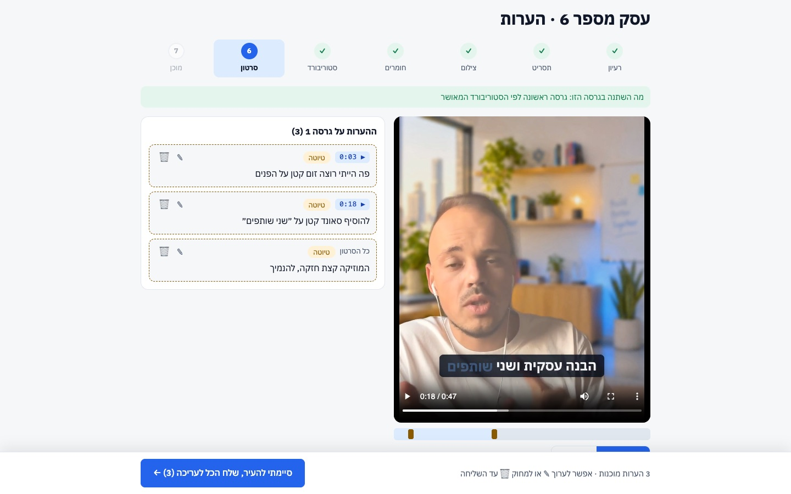
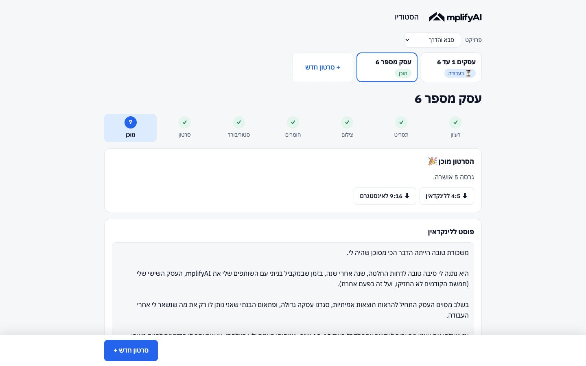

# הסטודיו של mplifyAI

דניס, זה המקום שבו הסרטונים שלך נולדים, מהרעיון ועד הקובץ שעולה ללינקדאין. הסוכן שלך ב-ChatGPT Work עושה את העבודה (כותב תסריטים, עורך, מתקן לפי ההערות שלך), ואתה רואה הכל בדפדפן ומחליט.

**רעיון ← תסריט ← צילום ← חומרים ← סטוריבורד ← סרטון ← מוכן**

בכל מסך יש כפתור כחול אחד בפס התחתון, והוא הצעד הבא. לא צריך לזכור כלום מעבר לזה.

- [התקנה, פעם אחת](#התקנה-פעם-אחת)
- [איך עובדים עם ChatGPT Work](#איך-עובדים-עם-chatgpt-work)
- [המדריך, שלב אחרי שלב](#המדריך-שלב-אחרי-שלב)
- [כשמשהו לא עובד](#כשמשהו-לא-עובד)

---

## התקנה, פעם אחת

לוקח בערך 15 דקות, רובן הורדות.

**1. החבילה הפרטית.** בדרייב שקיבלת יש תיקייה בשם **mplifyai-private**. לוחצים עליה ימני ← הורדה. הדרייב מוריד אותה כקובץ zip, משאירים אותו בתיקיית ההורדות כמו שהוא. בתוכו הקול שלך, מאגר הסיפורים, התמונות שלך וסדרת ״סבא והדרך״. הוא לא נמצא בריפו בכוונה, כי הריפו פתוח לכולם.

**2. מבקשים מ-ChatGPT Work להתקין.** פותחים את אפליקציית ChatGPT, נכנסים ל-Work, בוחרים תיקייה ריקה במחשב (למשל `Documents`) ומדביקים:

> תוריד את הריפו https://github.com/octaloom-bit/mplifyai-studio עם `git clone --recursive`, תיכנס לתיקייה `mplifyai-studio` ותריץ `npm run setup`. אם חסרים Node.js, Python או ffmpeg, תתקין אותם (במק עם brew). תמשיך עד שמופיעה המילה READY.

ההתקנה מוצאת לבד את החבילה בהורדות ושמה כל קובץ במקום שלו. אפשר להריץ אותה שוב מתי שרוצים, היא אף פעם לא דורסת סרטונים או שינויים שלך.

**3. מעבירים את ChatGPT Work לתיקייה `mplifyai-studio`.** מעכשיו זו תיקיית העבודה שלו. בתוכה יש קובץ `AGENTS.md`, והוא קורא אותו לבד בכל פעם: שם כתוב לו בדיוק מה לעשות בכל שלב.

<details>
<summary>מעדיף לבד בטרמינל?</summary>

```bash
brew install node python ffmpeg          # אם עוד אין
git clone --recursive https://github.com/octaloom-bit/mplifyai-studio.git
cd mplifyai-studio
npm run setup                            # מסתיים ב-READY
```
</details>

---

## איך עובדים עם ChatGPT Work

הסטודיו (בדפדפן) והסוכן (ב-ChatGPT Work) עובדים על אותה תיקייה. אתה לוחץ על כפתור בסטודיו, הבקשה נשמרת בתיקייה, ואז אתה אומר לסוכן לטפל בה.

**להפעיל את הסטודיו.** אומרים לסוכן:

> תפעיל את הסטודיו

(הוא מריץ `npm start`). הדפדפן נפתח בכתובת http://localhost:4321. אם לא נפתח, מעתיקים את הכתובת לדפדפן.

**אחרי כל כפתור כחול ששולח משהו לסוכן**, חוזרים ל-ChatGPT Work ואומרים:

> יש בקשות חדשות בסטודיו, תטפל לפי AGENTS.md

הסטודיו מראה למעלה ⏳ מה הסוכן עושה עכשיו, והדף מתעדכן לבד כשהוא מסיים. לא צריך לרענן.

כמה דברים שכדאי לדעת:
- **שיחה אחת לכל סרטון** ב-ChatGPT Work זה הכי נוח. ככה הוא זוכר מה כבר עשה.
- **עריכה לוקחת זמן** (כמה דקות עד רבע שעה, תלוי באורך). אפשר לסגור את החלון ולחזור.
- **לא צריך שום מנוי בתשלום** חוץ מ-ChatGPT. אם יש לסוכן כלי AI לתמונות, וידאו או מוזיקה, הוא יכול להשתמש בהם, אבל הכל עובד גם בלעדיהם.
- הסרטונים שלך נשארים רק במחשב שלך. שום דבר לא עולה לאינטרנט.

---

## המדריך, שלב אחרי שלב

### 1 · רעיון



לוחצים **״+ סרטון חדש״**, נותנים שם עבודה וכותבים על מה הסרטון. משפט אחד מספיק. אם יש סיפור אמיתי שקשור, כותבים אותו בשדה השני, ככה התסריט יוצא שלך ולא כללי.

כפתור כחול: **״תכתוב לי 3 תסריטים״** ← ואז אומרים לסוכן שיש בקשה חדשה.

### 2 · תסריט



הסוכן מחזיר 3 תסריטים, כל אחד מזווית אחרת. בכל אחד מסומנים **הוק** (3 השניות הראשונות, הכי חשובות), **ריהוק** (המשפט באמצע שמחזיר את מי שכמעט גלל הלאה) ו**סיום**. מתחת יש שעון וצ׳קליסט: ✓ ירוק זה טוב, ✗ כתום אומר מה כדאי לתקן.

לוחצים **״לעבוד על התסריט הזה״**, משנים מילים כמו שאתה מדבר, והטיימר מתעדכן תוך כדי. לא אהבת אף אחד? ״עוד 3 אפשרויות״ וכותבים מה לשנות.

הכלל: עד דקה וחצי. קצר יותר זה עוד יותר טוב.

כפתור כחול: **״זה התסריט, אני מצלם״**.

### 3 · צילום



טלפרומפטר: לוחצים **״התחלה״**, הטקסט עולה לבד ואתה קורא ומסתכל למצלמה. רווח עוצר וממשיך, ‎+ / −‎ משנים מהירות, ו״מסך מלא״ אם מצלמים מול המחשב.

הצ׳קליסט למטה חוסך את רוב הבעיות בעריכה: אור מהחלון מולך, מצלמה בגובה העיניים, אנכי, חדר שקט, שני טייקים של ההוק, ושנייה של שקט לפני ואחרי.

כפתור כחול: **״צילמתי, להעלאה״**.

### 4 · חומרים



גוררים את קובץ הסרטון לריבוע (או לוחצים ובוחרים מהמחשב). גם קבצים גדולים מהאייפון עובדים, רואים פס התקדמות. הסרטון בדרייב? מדביקים קישור והסוכן מוריד אותו.

כפתור כחול: **״החומרים כאן, תכינו סטוריבורד״** ← אומרים לסוכן.

### 5 · סטוריבורד



לפני שמישהו נוגע בעריכה, רואים מה יקרה בכל שנייה: מה נאמר, איזו מילה תודגש בכתוביות, איפה יש זום, תמונה או סאונד. הסוכן בונה את זה ממה **שבאמת אמרת** בצילום, אז אם דילגת על משפט, תראה את זה כאן.

רוצה לשנות שורה? **״+ הערה״** לידה. הכל טוב? כפתור כחול **״מאשר, תערכו״** ← אומרים לסוכן. אם כתבת הערות, הכפתור הופך ל״שלח הערות לסטוריבורד״.

### 6 · סרטון



הסרטון מימין, ההערות שלך משמאל.

- צופים, וברגע שמשהו לא מתאים **פשוט מתחילים להקליד** בתיבה שמתחת לסרטון. הסרטון עוצר לבד והשנייה נשמרת. Enter מוסיף את ההערה לרשימה.
- הערה על כל הסרטון (מוזיקה, קצב, צבע)? בוחרים **״כל הסרטון״** במתג שליד התיבה.
- כל עוד לא שלחת, אפשר לערוך ✎ או למחוק 🗑. לחיצה על הזמן (▶ 0:18) קופצת לרגע הזה.
- מקלדת: רווח = נגן/עצור · חצים = שנייה אחורה/קדימה · N = הערה חדשה.

כשסיימת: **״סיימתי להעיר, שלח הכל לעריכה״** ← אומרים לסוכן. הוא מחזיר גרסה חדשה, ולמעלה כתוב מה השתנה ומה הוא ענה על כל הערה. אין הערות? הכפתור הופך ל**״הכל טוב, מאשר את הגרסה״**.

### 7 · מוכן



שני כפתורי הורדה: **4:5 ללינקדאין** ו-**9:16 לאינסטגרם**. מתחת יש טיוטת פוסט ללינקדאין בקול שלך, עם כפתור העתקה. עוברים עליה לפני שמפרסמים, היא טיוטה.

כפתור כחול: **״סרטון חדש״**.

---

## הדוגמה: ״סבא והדרך״

בפרויקט ״סבא והדרך״ (מגיע בחבילה הפרטית, בוחרים אותו למעלה ב״פרויקט״) יש את שני הפרקים שכבר עשינו: התסריטים, הסטוריבורד, ההערות על כל גרסה והגרסאות עצמן. ככה נראה סבב שלם, וגם הסוכן לומד ממנו את הסגנון.

---

## כשמשהו לא עובד

| מה רואים | מה עושים |
|---|---|
| הדף לא נפתח / ״לא נשמר״ | הסטודיו כבוי. אומרים לסוכן ״תפעיל את הסטודיו״ |
| לחצתי על כפתור כחול ושום דבר לא קורה | הבקשה נשמרה, צריך להגיד לסוכן ״יש בקשות חדשות בסטודיו, תטפל לפי AGENTS.md״ |
| הסוכן אומר שחסרים קבצי קול | החבילה הפרטית לא נמצאה. מורידים שוב את התיקייה mplifyai-private מהדרייב להורדות ומבקשים ״תריץ npm run setup״ |
| ההתקנה נעצרה עם NEED_FFMPEG או NEED_NODE | מבקשים מהסוכן להתקין את מה שחסר ולהריץ שוב |
| הכתוביות לא תואמות למה שאמרתי | כותבים הערה על השנייה הזו. הסוכן בודק כל גרסה מול מה שנשמע, אבל עדיף שתגיד |

---

## מה יש בתיקייה

| | |
|---|---|
| `AGENTS.md` | ההוראות לסוכן: מה עושים בכל בקשה ואיך עורכים |
| `skills/short-video-scriptwriting/` | איך כותבים תסריט קצר שמחזיק עד הסוף |
| `brands/mplifyai/` | הצבעים, הלוגו, הפונטים וה-design system של mplifyAI |
| `projects/` | הסרטונים שלך (נשארים רק אצלך) |
| `docs/UX.md` | כל כפתור בסטודיו ומה הוא עושה |

## קרדיטים

אפקטי הווידאו: [claude-video-effects](https://github.com/Vibha-Ramprakash/claude-video-effects) (MIT) עם תמיכה בעברית. רינדור: [HyperFrames](https://hyperframes.heygen.com) (Apache-2.0). תמלול: ivrit-ai/whisper-large-v3-turbo. פונטים: IBM Plex (OFL).

נבנה עבורך ב-[OctaLoom](https://octaloom.com).
